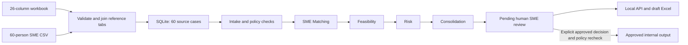

# FORGE final source and workflow check

## Active local data

- `data/private/FORGE_60_Opportunities_26_Column_Agent_Input.xlsx` is the final workbook copied byte for byte from the supplied `(1).xlsx` file. Its `Opportunity_Input` sheet has 60 unique `SOC-...` IDs and 26 columns. `Master_Consolidated` repeats those 26 fields for the same 60 IDs; the importer checks that they agree.
- `data/private/Kyndryl_Synthetic_SME_Directory_60.csv` remains the active 60-person specialist source. The workbook's 12-row `SME_Directory` tab is validated as source context but is not silently mixed into recommendations. `app/final_sme_rules.py` links the final workbook's optimization labels to supported CSV specializations. **33 cases have an available mapped SME; 27 require staffing review.** The supplied CSV is unchanged.
- `data/private/opportunity_details.csv` is the private 26-column inspection copy. `data/opportunity_summary.csv` contains only six aggregate practice rows. Run `scripts/build_summary.py` after replacing the workbook to refresh both.
- The final catalog uses a new local SQLite file, `runtime/forge_final.sqlite`, and checkpoint file, `runtime/langgraph_final.sqlite`. Earlier local databases remain separate.

The source stages are 1 Stretch, 19 Won, 20 Validated, 10 Qualified, 5 Noticed, and 5 Identified. Source stage is not a FORGE review decision.

## How one case moves



`app/graph.py` runs the four agents in that exact order. The assessment is stored through `app/services.py` and returned by FastAPI. The graph pauses at the existing human review step; it does not approve or reject automatically. The client Streamlit dashboard reads aggregate metrics only and does not show individual opportunity names or SME identities. No GTM, CRM, or external handoff is used.

## Current evidence limits

The final workbook is structurally valid, and all 54 linked evidence savings values equal source baseline minus proposed monthly cost. Its evidence collection date is **2026-04-01** for all 54 records. As of **2026-11-05**, all exceed the existing 180-day freshness rule. Six opportunities have no evidence ID.

All 60 contract rows say `Active`, but they do not state whether the specific proposed optimization is in scope. The importer therefore records `scope=unknown`; it never turns `Active` into approval. Fourteen cases share customer and practice with an existing-opportunity row. Those rows lack asset and optimization keys, so they are flagged for possible duplicate review and are not called exact duplicates.

One case, `SOC-0ALB-DESCOPE`, has a source one-time amount of **−$26,000**, meaning a credit. FORGE preserves the signed source value and displays the credit as **unvalidated**. It does not add that credit to validated first-year customer benefit.

Consequently **all 60 cases are currently on policy HOLD**. This is a truthful output from the final source data, not an ingestion or graph failure. A case can only reach approved internal output after current evidence, verified scope, any staffing or duplicate questions, and the explicit human decision are resolved. The 19 source-stage `Won` rows remain historical and are blocked by policy.

## Run and visually inspect

From the inner `FORGE-` folder in PowerShell:

```powershell
.\.venv\Scripts\python.exe scripts\check_data.py
.\.venv\Scripts\python.exe scripts\build_summary.py
.\.venv\Scripts\python.exe scripts\seed_db.py --source workbook
.\.venv\Scripts\python.exe scripts\trace_flow.py SOC-1F91OWU
.\.venv\Scripts\python.exe scripts\export_draft.py SOC-1F91OWU
.\.venv\Scripts\python.exe -m pytest -q
```

The trace should show `intake → assessment → sme_matching → feasibility → risk → consolidation`, followed by `review_status: pending`. For `SOC-1F91OWU`, it should show `SME-003`, feasibility `48.0 LOW`, risk `UNCERTAIN` with no overall risk score, and the missing item `validated_financial_evidence`. The Social Impact proxy remains provisional. Use `scripts\trace_flow.py SOC-1F91OWU --json` for the complete internal response.

Open `dashboard/exports/SOC-1F91OWU_FORGE_internal_assessment.xlsx` in Excel to inspect the **DRAFT - INTERNAL POC ONLY** brief and the `FORGE Assessment` sheet. That folder is ignored by Git. The approved export command remains unavailable until policy gates and human approval are satisfied.

For a browser view, start the API:

```powershell
.\.venv\Scripts\python.exe -m uvicorn app.api:app --host 127.0.0.1 --port 8000
```

Open `http://127.0.0.1:8000/docs`. Run `POST /api/opportunities/{opportunity_id}/evaluate` with `SOC-1F91OWU`. Expand the response's `result.trace`, `sme_matching`, `feasibility`, `risk_assessment`, `consolidation`, `blockers`, and `review_status`. Open `GET /api/opportunities/{opportunity_id}` to see the stored case and review record. The approved-summary endpoint should return 409 until all policy gates and explicit review are satisfied.

In a second PowerShell terminal, run:

```powershell
.\.venv\Scripts\python.exe -m streamlit run dashboard\streamlit_app.py --server.address 127.0.0.1 --server.port 8501
```

Open `http://127.0.0.1:8501`. Expect 60 total opportunities and the six source-stage counts above. The client page intentionally does not show the case-level trace; use the local API docs or trace script for that confidential internal view. Excel export remains a **draft internal assessment** while policy blockers remain.
